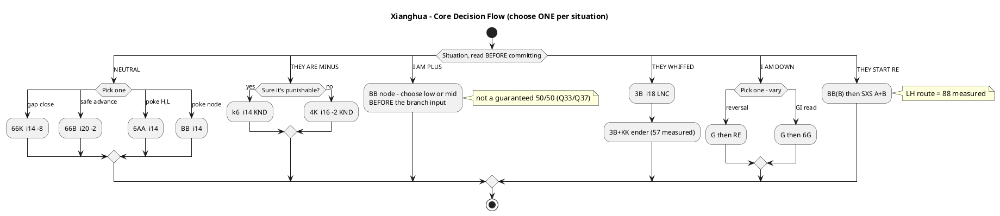
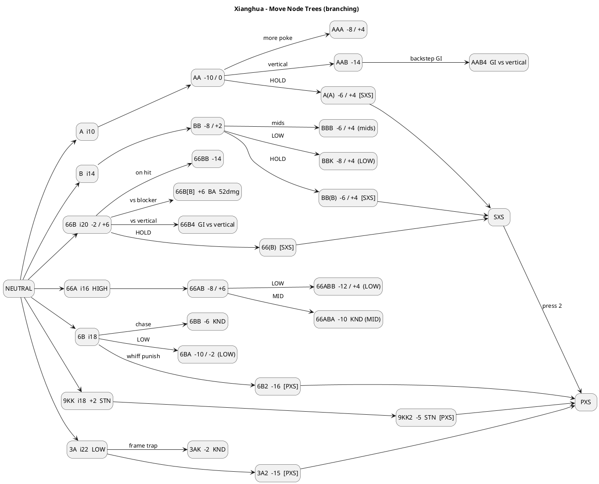
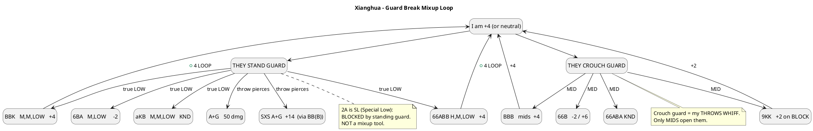
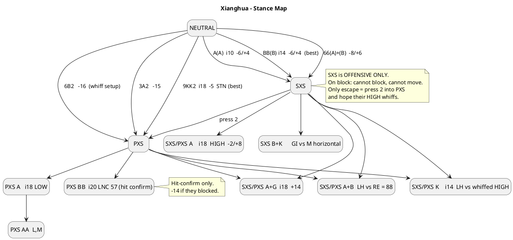

# PlantUML Flowcharts

Paste any block into **https://www.plantuml.com/plantuml/uml/** (or the JS renderer).
✅ **All four validated against the live PlantUML server** — invalid syntax returns
HTTP 400, these return 200.

| # | Diagram | Use |
|---|---|---|
| 1 | Core decision flow | "What do I press *right now*?" |
| 2 | Move node trees | See every branch off `AA`, `BB`, `66B`, `6B`… |
| 3 | Guard-break mixup | The stand/crouch triangle + the loop |
| 4 | Stance map | What SXS/PXS actually give me |

---

## 1. Core decision flow

> Activity syntax. Each `switch` = **pick ONE before pressing**; boxes stacked under one case are a real sequence (combo), not alternatives. Values are 📊 raw data unless marked.



---

## 2. Move node trees

> The point of this one: **which moves give me a choice.** A node with a LOW
> branch *and* a MID branch is a mixup. A node with an `[SXS]`/`[PXS]` branch is
> stance access.




---

## 3. Guard-break mixup



---

## 4. Stance map



---

## Regenerating / validating

```powershell
# valid -> HTTP 200 ; syntax error -> HTTP 400
$src = Get-Content diagram.puml -Raw
$hex = ([Text.Encoding]::UTF8.GetBytes($src) | % { $_.ToString("x2") }) -join ""
Invoke-WebRequest "https://www.plantuml.com/plantuml/svg/~h$hex" -UseBasicParsing
```

⚠️ PlantUML **auto-closes a missing `endif`** — a rendered diagram is not proof the
logic is right, only that the syntax parses.


